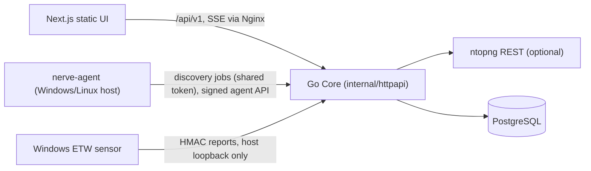

# Architecture

How NERVE is put together and how data flows through it, for maintainers changing the
code. [IMPLEMENTATION_PLAN.md](../IMPLEMENTATION_PLAN.md) records the current state, the
data model, sequencing, technical risks and the privilege boundary; subsystem details are
in the other `docs/` pages (device identity, remote management, agent setup, traffic
sensor and maps). Decisions made from now on are recorded in
[`DECISIONS/`](DECISIONS/README.md).

## In one paragraph

NERVE is a self-hosted network inventory, discovery and traffic-visualization platform.
A Go Core (`cmd/nerve-server`) serves a JSON API under `/api/v1`, Server-Sent Events and
health endpoints, and owns PostgreSQL through ordered, checksummed migrations. A static
Next.js UI (`app/`, `components/`, `lib/api.ts`) talks to it same-origin through an Nginx
proxy (`deploy/nginx.conf`); Docker Compose runs PostgreSQL, the API and the web
container. Anything that needs raw network access runs outside the Core container: the
native Go agent (`cmd/nerve-agent`) for discovery and remote management, and the .NET
Windows ETW traffic sensor (`native/windows-sensor`).

## Layers and boundaries

| Package | Owns |
| --- | --- |
| `internal/httpapi` | Routing, request limits, sessions on requests, JSON errors, SSE |
| `internal/auth`, `internal/authz`, `internal/audit` | Bootstrap, sessions, login rate limiting; role-to-permission checks; append-only audit log |
| `internal/inventory`, `internal/devices` | Device read model and search; operator-owned identity, evidence, duplicates, merge and split |
| `internal/discovery` | Discovery target, persistent scan jobs, report reconciliation (MAC first), match rules |
| `internal/agents`, `internal/agentproto` | Enrollment tokens, per-agent Ed25519 identities, signed protocol, Core response signing, device association |
| `internal/remote` | Provider-neutral remote management: providers, policies, audited command pipeline |
| `internal/traffic`, `internal/integrations/ntopng` | Normalized live-traffic snapshot, sensor ingest, ntopng adapter |
| `internal/platform`, `internal/config` | Database pool, migrations, configuration from the environment |

Boundaries that must hold:

- Secrets (session tokens, integration credentials, signing keys) never reach browser code,
  logs or audit parameters. `NERVE_CORE_SIGNING_KEY` comes only from the environment.
- The sensor ingest listener is published on host loopback only, never through Nginx.
- Raw-socket work (ICMP, ARP/NDP, capture) stays in native host agents, never in Core.
- Applied migrations are never edited; checksums are verified on start.
- Views show observed data with provenance; derived structure (for example /24 plates in
  the 3D map) is labelled as derived.

## Data flow

Discovery: an administrator saves the target subnet (`POST /api/v1/discovery/target`) and
queues a scan (`POST /api/v1/discovery/scans`); the database allows one active scan. The
native agent claims the job (`.../discovery/agent/jobs/claim`), probes the network, posts
reports and completes the job. `internal/discovery` reconciles each report into devices,
interfaces and addresses (MAC first, then subnet and IP, using the explicit match rules),
records identity evidence, and updates online/offline state; changes reach open UIs through
SSE (one shared PostgreSQL listener).

Remote commands: an operator with the permission queues one of the read-only commands
(`POST /api/v1/agents/{agentID}/commands`); `internal/remote` stores and audits it. The
enrolled agent claims it over the signed agent API (`/api/v1/agent/commands/claim`), reports
start and result, and the at-most-once pipeline stores the result for the device's command
history. Operators can cancel queued commands.

## Testing

| Layer | Command | Covers |
| --- | --- | --- |
| Go unit tests | `go test ./...` | Packages under `internal/` and `cmd/` |
| Go integration tests | `go test -tags=integration -count=1 -p 1 ./...` | Real PostgreSQL 17 with isolated schemas (`NERVE_TEST_DATABASE_URL`) |
| Frontend | `npm run typecheck`, `npm run test:map`, `npm run build` | Types, map geometry and topology layout, static runtime check |
| Images and artifacts | `docker build` per Dockerfile | API, web, agent (Windows, Linux) and sensor builds |
| Workflow | `node --test "scripts/workflow/*.test.mjs"` | Development tooling only: session hook, board merge driver, Claude Code config |

CI (`.github/workflows/ci.yml`) runs the Go, frontend and image checks plus an API startup
smoke test; `workflow-checks.yml` runs the workflow tests when workflow files change.

## Extending

- New API behaviour: handler in `internal/httpapi`, domain logic in its package, permission
  in `role_permissions` through a new migration, audit entry, typed client in `lib/api.ts`.
- New collector or integration: its own package (`internal/integrations/<name>`) added with
  its first real behaviour; credentials encrypted and server-side only.
- New remote command: through `internal/remote` and the signed agent protocol; privileged
  commands stay blocked until the prerequisites in the implementation plan exist.
